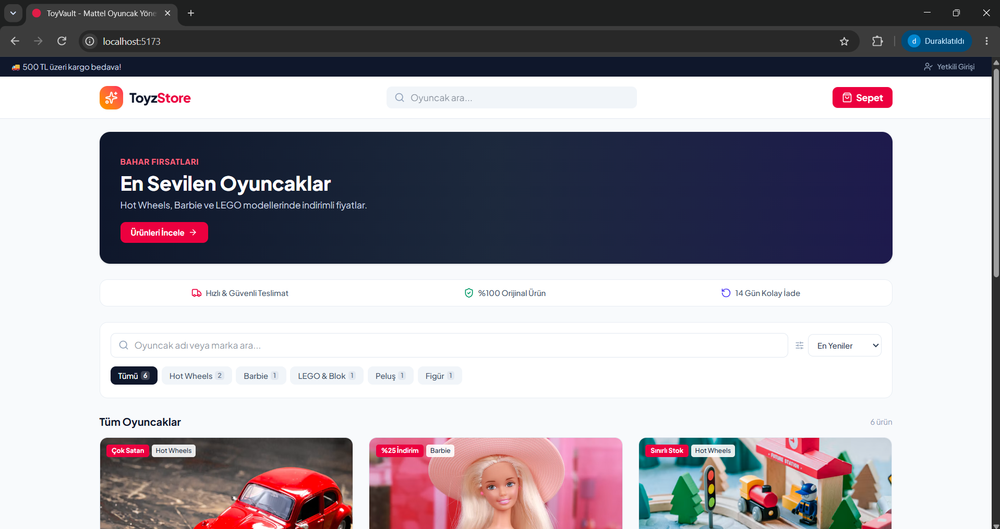
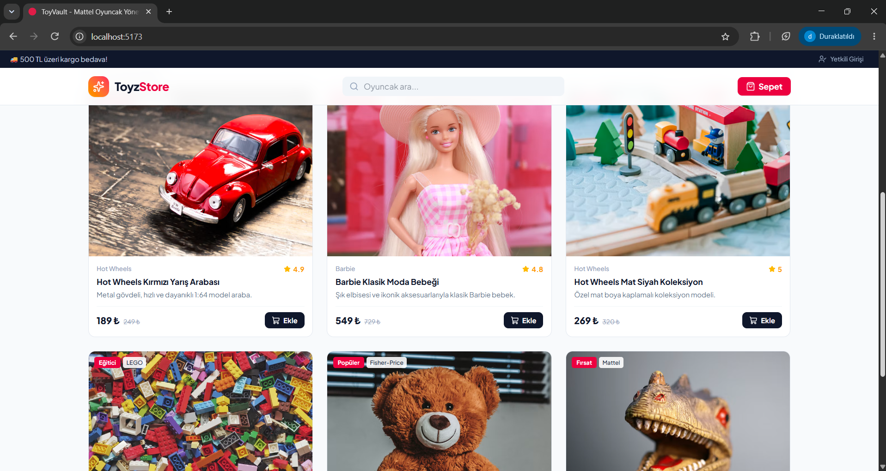
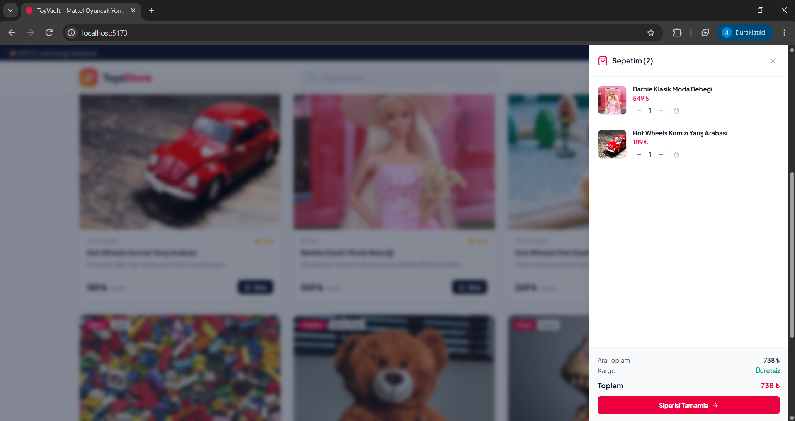

# 🧸 ToyzStore - Modern E-Ticaret & Oyuncak Satış Mağazası

**ToyzStore**, modern web standartlarına uygun olarak **React 19**, **Tailwind CSS v4** ve **LocalStorage** kullanılarak geliştirilmiş, gerçek bir e-ticaret satış ve ürün yönetim platformudur.

🔗 **Canlı Demo (Netlify):** [https://toyzstore-demo.netlify.app](https://toyzstore-demo.netlify.app) *(Kendi Netlify linkinizi buraya ekleyebilirsiniz)*  
📁 **GitHub Deposu:** [https://github.com/kullanici-adiniz/toy-store-app](https://github.com/kullanici-adiniz/toy-store-app)

---

## 📸 Proje Ekran Görüntüleri

### 1. Mağaza Vitrini & Ürün Kataloğu


### 2. Ürünler


### 3. Alışveriş Sepeti Çekmecesi (Cart Drawer)


---

## ✨ Öne Çıkan Özellikler

* 🛒 **Gerçek E-Ticaret Deneyimi:**
  * Ürün vitrini, indirimli ve eski fiyatlar, müşteri yıldız puanları, stok uyarıları.
  * **Alışveriş Sepeti (Cart Drawer):** Sağdan açılan çekmece ile sepete ekleme, adet artırma/azaltma, 500 TL üzeri ücretsiz kargo hesaplayıcısı ve sipariş tamamlama akışı.
* ⚡ **Tam Kapsamlı CRUD & Mağaza Yönetimi (Yönerge Şartları):**
  * **Ekleme (Create):** Yetkili panelinde "Yeni Ürün Ekle" butonu ile resim önizlemeli, doğrulama kontrollü form.
  * **Listeleme (Read):** Canlı arama kutusu, kategori butonları (Hot Wheels, Barbie, LEGO vb.) ve fiyata/stoğa göre akıllı sıralama.
  * **Güncelleme (Update):** Her ürün kartından açılan düzenleme penceresi ile fiyat, stok, ad ve görsel güncelleme.
  * **Silme (Delete):** Güvenli silme onay modalı ile listeden ve sepetten ürün çıkarma.
* 🛡️ **Yönetici / Müşteri Modu Ayrımı:**
  * Varsayılan olarak saf e-ticaret müşteri görünümü açıktır.
  * Üst bardaki *"Yetkili Girişi"* düğmesiyle yöneticiler ürün ekleme/düzenleme/silme yetkilerini açıp kapatabilir.
* 💾 **Kalıcı Bellek (LocalStorage):**
  * Hem mağaza ürün kataloğu hem de müşteri sepeti tarayıcının `LocalStorage` alanında saklanır. Sayfa yenilense de veriler kaybolmaz.
* 🎨 **Modern ve Mobil Uyumlu Tasarım:**
  * Tailwind CSS v4 ile responsive (masaüstü, tablet, mobil) arayüz.

---

## 📂 Dosya & Mimari Yapısı

```text
toy-store-app/
├── public/
│   └── _redirects              # Netlify SPA yönlendirmesi
├── screenshots/
│   ├── anasayfa.png            # Vitrin ekran görüntüsü
│   ├── anasayfa2.png           # Yönetim ekran görüntüsü
│   └── sepet.png               # Sepet ekran görüntüsü
├── src/
│   ├── Components/             # Arayüz bileşenleri
│   │   ├── CartDrawer.jsx      # Alışveriş sepeti çekmecesi
│   │   ├── DeleteConfirmModal.jsx # Silme onay modalı
│   │   ├── FilterBar.jsx       # Arama, filtreleme ve sıralama çubuğu
│   │   ├── Navbar.jsx          # E-ticaret üst barı & sepet butonu
│   │   ├── Toast.jsx           # Bildirim mesajları
│   │   ├── ToyCard.jsx         # Ürün satış kartı
│   │   ├── ToyList.jsx         # Ürün kataloğu ızgarası
│   │   └── ToyModal.jsx        # Ürün ekleme & düzenleme formu
│   ├── Interfaces/             # Veri modelleri ve başlangıç ürünleri
│   │   └── toy.interface.js    # Ürün şeması ve yüksek kaliteli görseller
│   ├── Pages/                  # Sayfa bileşenleri
│   │   └── HomePage.jsx        # Ana vitrin ve durum yönetimi
│   ├── utils/                  # Yardımcı fonksiyonlar
│   │   └── storage.js          # LocalStorage okuma / yazma
│   ├── App.jsx
│   ├── index.css               # Tailwind CSS tanımları
│   └── main.jsx
├── netlify.toml                # Netlify dağıtım yapılandırması
├── package.json
└── vite.config.js
```

---

## 🚀 Yerel Kurulum (Local Development)

```bash
# 1. Bağımlılıkları yükleyin
npm install

# 2. Geliştirme sunucusunu başlatın
npm run dev

# 3. Üretim derlemesi
npm run build
```
Tarayıcınızda `http://localhost:5173` adresine giderek alışveriş sitesini test edebilirsiniz.

---

## 🌐 Netlify Üzerinde Yayına Alma (Deploy)

1. Projenizi GitHub'a yükleyin (`git push`).
2. [Netlify](https://www.netlify.com/)'a giriş yapın ve **"Add new site" > "Import an existing project"** seçeneğini seçin.
3. GitHub deponuzu seçin.
4. Derleme ayarlarını kontrol edin:
   * **Build command:** `npm run build`
   * **Publish directory:** `dist`
5. **"Deploy site"** butonuna basarak saniyeler içinde yayına alın!
